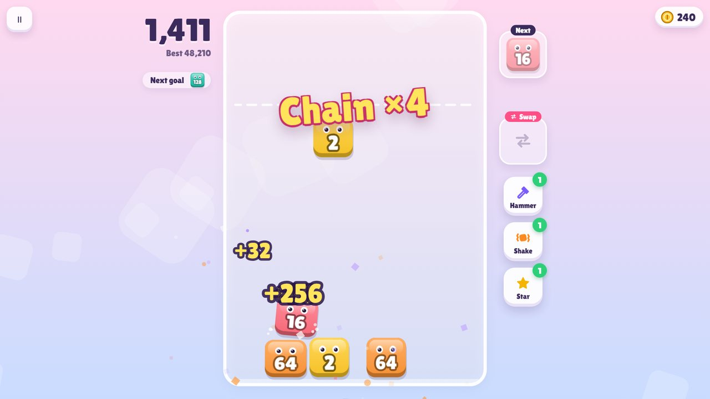

# Cube Cascade

**Drop. Merge. Chain.**

### [Play it now in your browser](https://r4ij3n-droid.github.io/cube-cascade/)

Numbered jelly cubes drop into a box, one at a time. Two cubes with the same number that touch merge into one with double the value: two 8s make a 16, two 16s make a 32, and so on. Each new cube pulls in its matching neighbours, so one good drop can set off a whole cascade, and every link in the chain multiplies your points.

Keep the stack under the line. If a cube comes to rest above it, a three-second countdown starts. Merge it away or smash it before it runs out, or the game is over.

**What's in it**

- Drag to aim and let go to drop, or follow the mouse and click. Arrow keys and Space work too.
- The next cube is always shown, and the Swap slot lets you trade for the cube you saved.
- A landing ghost shows exactly where your cube will end up.
- Three tools for tight spots: the Hammer smashes one cube, Shake jolts the box loose, and the Star merges with anything it touches.
- One second chance per game.
- Missions that pay coins, a daily gift that grows over a seven-day streak, and six themes to unlock: Candy, Mint, Sunset, Ocean, Neon and Gold.
- Plays in portrait or landscape, in English or Arabic.

Made by Raijen Studio for YouTube Playables.
